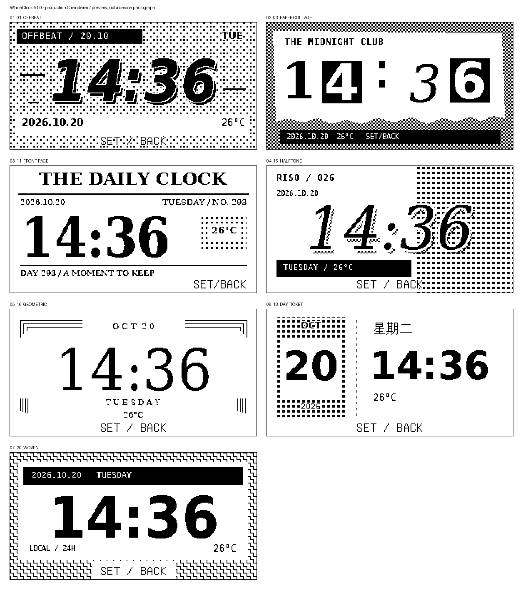
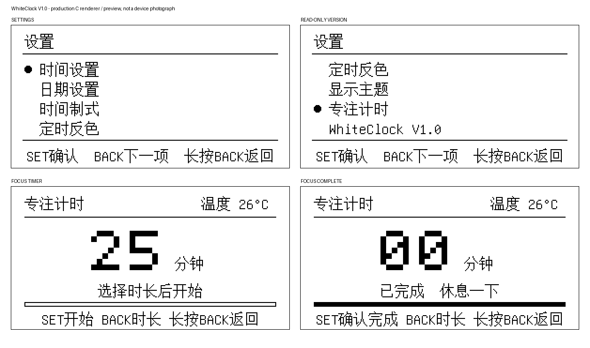

# WhiteClock

基于 CW32L010F8U6 的 2.66 英寸黑白墨水屏桌面时钟，支持七套抖动主题、两键设置、定时反色和番茄钟。

当前版本 **WhiteClock V1.0** 已完成实机烧录和 64 KiB 整片回读。用户确认显示正常、主题切换明显变快，按住 BACK 即可返回。



## 功能

- 七套主题：错版、撕纸、头版、半调、几何、日牌、织纹，保留多种数字字体、黑白网点和纹理。
- 时间、中文日期与星期，12/24 小时制，跨午夜定时反色。
- SET / BACK 两键操作，菜单用文字前方的圆点标示选择，末尾显示只读 `WhiteClock V1.0`。
- 番茄钟支持 5 / 15 / 25 / 45 / 60 分钟，暂停、继续、重置，到时全刷提醒五次。
- 显示芯片温度近似值；无有效数据时显示占位符。
- 显示设置掉电保存；保留外部 32768 Hz 晶振 RTC。

## 两键操作

| 场景 | SET | BACK 短按 | BACK 长按 |
|---|---|---|---|
| 时间主页 | 进入设置菜单 | 进入番茄钟 | 无操作 |
| 设置菜单 | 进入选中项 | 下一项 | 返回主页 |
| 时间 / 日期 / 反色编辑 | 修改，选中保存项时保存 | 下一字段 | 取消并返回 |
| 主题 / 时间制式 | 保存并返回 | 切换与预览 | 取消并返回 |
| 番茄钟 | 开始 / 暂停 / 继续 / 确认完成 | 选时长或重置 | 返回入口，计时继续 |

BACK 按住约 **0.7 秒**就触发返回，不必松手。可编辑数字的 SET 连发在按住 0.5 秒后开始。墨水屏仍有物理刷新时间，按键事件与画面完成并非同一时刻。



## 硬件

| 项目 | 配置 |
|---|---|
| MCU | CW32L010F8U6，Cortex-M0+，24 MHz |
| 存储 | 64 KiB Flash / 4 KiB RAM |
| 屏幕 | 2.66 英寸，物理 152 × 296，横向画布 296 × 152 |
| 屏幕协议 | 按 UC8251 单字节 PSR 驱动，保留原机 LUT |
| SPI | PA5 SCK / PA6 MOSI，6 MHz；BUSY PA1 / RST PA2 / CS PA3 / DC PA4 |
| 按键 | BACK PB2（原 K1）/ SET PB3（原 K2），低有效 |
| 调试 | SWD PA7 / PA8，使用 WCH-Link |
| RTC | 外部 32768 Hz LSE |

## 刷新与容量

日常更新使用原厂差分快刷波形，但仍上传完整 OLD / NEW 双帧；已验证异常的裁剪窗口默认关闭。首屏、反色切换和七次快刷后的下一次更新使用完整波形。

主题资源按面板扫描顺序存储，背景整字节复制，字形按列读取，背景和字体各用 512 字节解码缓存，不分配全屏帧缓冲。SPI、屏幕等待、ADC 和运行时 RTC 保存分步执行，按键优先处理。

| V1.0 已安装镜像 | 用量 |
|---|---|
| 程序 Flash | 61,252 / 64,000 字节，剩余 2,748 字节 |
| 静态 RAM | 2,572 / 4,096 字节，至栈顶余 1,524 字节 |
| 设置页 | `0xFA00` / `0xFC00`，双页 CRC；不擦写 `0xFE00` 安全页 |
| 启动刷新记录 | 1,845 ms，其中 BUSY 1,042 ms；不是菜单响应时间 |

当前固件、校验清单和字体许可见 [V1.0 产物](cw32l010_clock/releases/whiteclock-v1-fast-20261020/)。[版本状态](cw32l010_clock/releases/status.json)记录镜像哈希、整片回读和验收范围。

## 开发

需要 ARM GNU Toolchain（`arm-none-eabi-gcc` / binutils）、Make、原生 C 编译器，以及 Python 3.12。Python 依赖版本固定在工程目录中。

```sh
git clone https://github.com/446599/WhiteClock.git
cd WhiteClock/cw32l010_clock
python3 -m venv .venv
. .venv/bin/activate
python -m pip install -r requirements-dev.txt
make -j4
python tools/verify_image.py
make test HOST_CC='cc -O2'
python -m unittest discover -s tests -p 'test_device.py'
```

首次构建会下载固定哈希的 GNU Unifont，后续可使用本地缓存。正式版本的主题资源头文件已随源码提供；重生成主题、逐像素资源验证、预览和安全烧录见 [工程指南](cw32l010_clock/README.md)。自动构建也会运行对应验证并上传固件、源码快照和预览。

## 目录

| 路径 | 内容 |
|---|---|
| `cw32l010_clock/user/` | 时钟交互、主题、屏幕、按键和 RTC 源码 |
| `cw32l010_clock/tests/` | 主机回归、逐像素验证和烧录保护测试 |
| `cw32l010_clock/tools/` | 构建资源、预览、镜像检查及 SWD 工具 |
| `cw32l010_clock/docs/` | 驱动研究、硬件说明和字体许可 |
| `cw32l010_clock/releases/` | 正式产物和历史版本状态 |
| `cw32l010_original_64k.bin` | 已校验的原机恢复备份 |
| `evidence/` | 已归档的验证记录；临时整片读回保留在本地 |

工程目录沿用 `cw32l010_clock/`，便于兼容现有工具和硬件资料；项目及仓库名称为 **WhiteClock**。

## 注意事项

烧录前核对芯片、原始备份、目标镜像及当前整片哈希，写入后必须完整回读；禁止整片擦除或自动解除读保护。SWD 接触不稳时不要继续操作，详见工程指南。

抖动是黑白空间网点，不是原生灰阶。芯温不是校准室温计；番茄钟没有声音提醒，状态不跨重启保存。长期残影、功耗、温度适应性和硬件栈水位尚未全面测量。

SDK 保留原作者版权声明。界面使用 GNU Unifont，主题字形使用 DejaVu 精简子集；许可文本随正式固件分发，见 [字体说明](cw32l010_clock/docs/FONT-LICENSE.md)。
